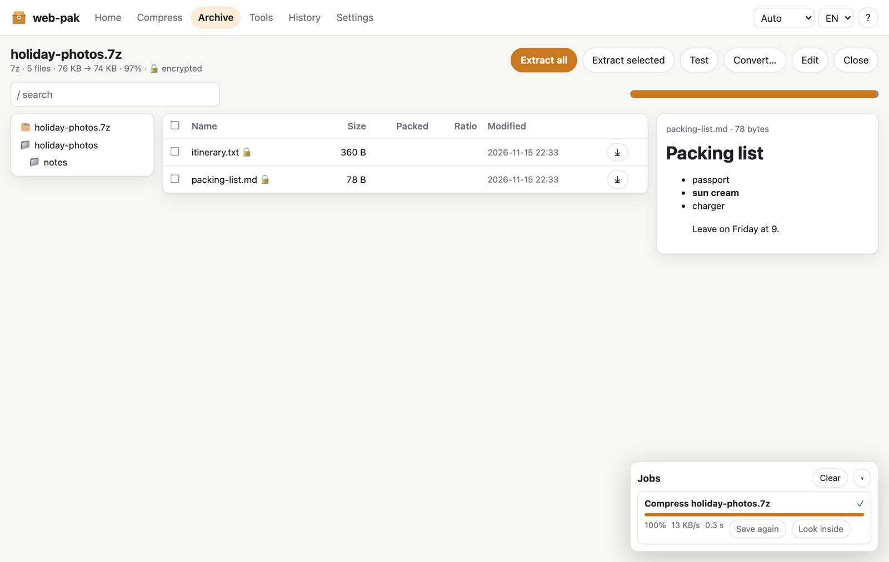
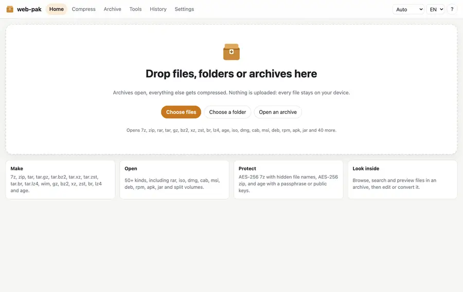
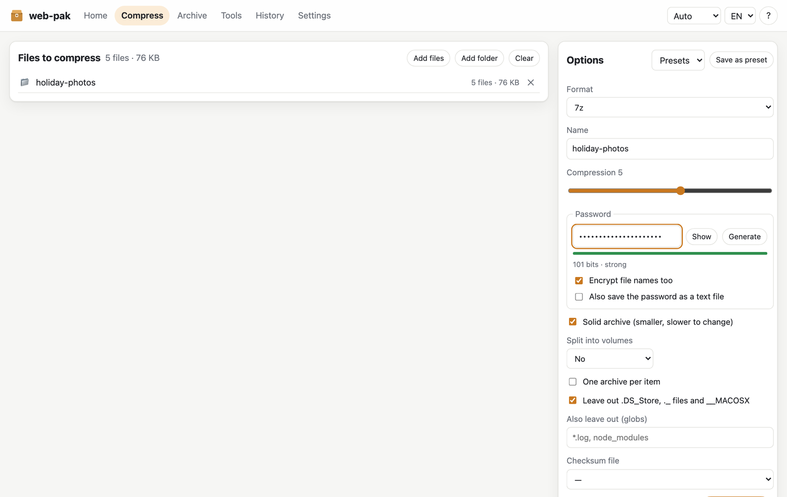
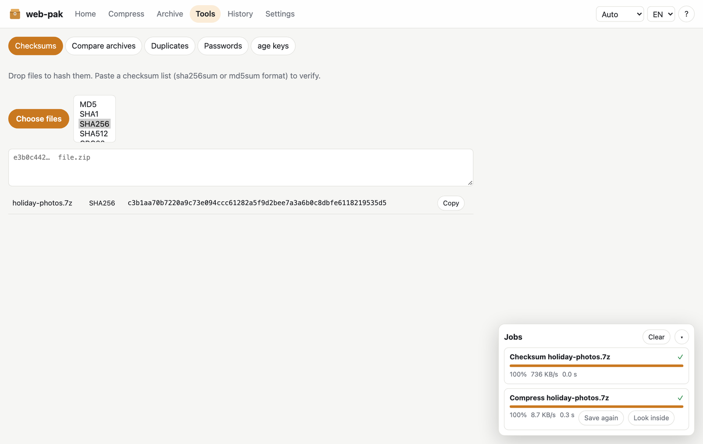
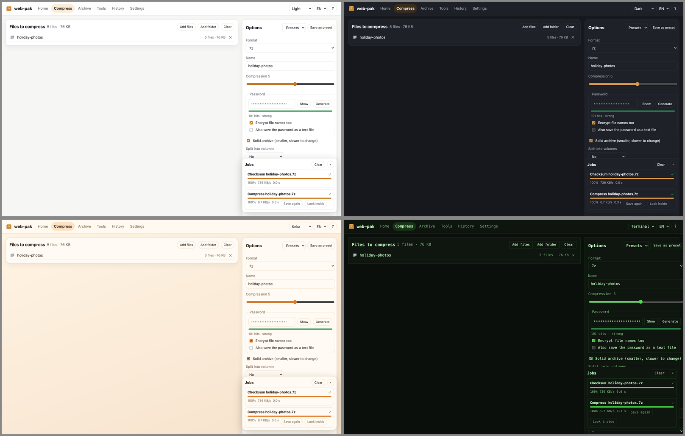

<div align="center">


# web-pak

**A file archiver in your browser: compress, extract, encrypt, browse, preview, edit and convert archives in 50+ formats. Nothing is uploaded.**

[Features](#features) · [Run it locally](#run-it-locally-step-by-step) · [Formats](#formats) · [Keys](#keys) · [Compared with pakket](#compared-with-pakket) · [How it works](#how-it-works) · [Limits](#limits) · [Contributing](#contributing)


[](https://github.com/Gitguy268/web-pak/actions/workflows/test.yml)



</div>

web-pak is the browser version of [pakket](https://github.com/Gitguy268/pakket), the terminal archiver. Drop files or folders and it compresses them; drop an archive and it opens. Everything happens on your own device: 7-Zip runs as WebAssembly in a background worker, and your files never leave the browser.

<!-- live-links -->
**Live:** [gitguy268.github.io/web-pak](https://gitguy268.github.io/web-pak/) · [web-pak.vercel.app](https://web-pak.vercel.app)
<!-- /live-links -->

<!-- run-steps:start -->
## Run it locally, step by step

1. **Get the code:**

   ```sh
   git clone https://github.com/Gitguy268/web-pak.git
   cd web-pak
   ```

2. **Double-click `start.command`** (macOS; on Linux run `./start.command`). It serves the ready-built `app/` folder with Python on <http://localhost:5194/> and opens it. Press `Ctrl+C` in the terminal to stop.

   Opening `index.html` directly doesn't work: browsers only run WebAssembly workers from a web address, and the page tells you so.

**To change the code** you need [Node.js](https://nodejs.org) 22 or newer:

```sh
npm ci
npm run dev        # live-reloading dev server on http://localhost:5193/
npm run build      # rebuilds app/
```
<!-- run-steps:end -->

## Features



- **Make 17 formats:** 7z, zip, tar, tar.gz, tar.bz2, tar.xz, tar.zst, tar.br, tar.lz4, wim, and gz, bz2, xz, zst, br, lz4 and age for single files (a folder is tarred first).
- **Open 50+ kinds:** everything 7-Zip 24 reads, from rar, iso, dmg and cab to msi, deb, rpm, apk, jar, epub and split volumes in any order, plus zst, br, lz4 and age. A `.tar` inside is unpacked in the same step.
- **Encryption:** AES-256 7z with hidden file names, AES-256 zip (or ZipCrypto for old tools), and [age](https://age-encryption.org) with a passphrase or public keys. A password generator and strength meter come with it.
- **Look inside without extracting:** a folder tree, a sortable table, search, a bar of sizes by file type, and previews of images, video, audio, PDF, text and code (with highlighting), markdown, and a hex view for everything else.
- **Edit and convert:** add, rename and remove entries, then save as the same or another format; turn a rar into a zip or a zip into an encrypted 7z.
- **pakket's options:** compression level 0 to 9, solid 7z, split volumes (email, CD, DVD and FAT32 presets or any size), one archive per item, leave out `.DS_Store`, `._` files, `__MACOSX` and your own globs, MD5 or SHA-256 checksum files, and a password text file. Save your options as presets.
- **Careful extraction:** a folder only when the archive holds more than one item, never `x/x`, `name 2` instead of overwriting, entries that would land outside the destination refused, and names in old zips fixed (CP437, Shift-JIS, GBK, Big5, EUC-KR, CP866, 1251, 1252).
- **Tools:** checksums (MD5, SHA-1, SHA-256, SHA-512, CRC32, BLAKE3, xxHash64) with verification against a pasted `sha256sum` list, comparing two archives, duplicates in an archive, and age key pairs.
- **A job queue:** jobs run in Web Workers, two at a time, with progress, speed, time left and cancel. A history keeps names, sizes and times (never contents or passwords).
- **Fits in:** installable as an app, works offline, opens archives from your file manager and from the share menu, keyboard shortcuts, four looks (light, dark, Keka and a terminal look like pakket's), English and Dutch.

<p align="center"></p>

<details>
<summary><b>More pictures: tools and the four looks</b></summary>

<p align="center"></p>
<p align="center"></p>

</details>

## Formats

| | Make | Open |
|---|---|---|
| **Archives** | 7z, zip, tar, wim | 7z, zip, zipx, rar (incl. rar5), tar, wim, cab, msi, cpio, xar, pkg, ar, arj, lzh, chm, nsis, squashfs, cramfs |
| **Compressed tarballs** | tar.gz, tar.bz2, tar.xz, tar.zst, tar.br, tar.lz4 | the same, plus tgz, tbz2, txz, tzst, tar.lzma, tar.Z |
| **Single files** | gz, bz2, xz, zst, br, lz4 | the same, plus lzma, Z |
| **Disk images** | | iso, udf, dmg, hfs, apfs, vhd, vhdx, vmdk, vdi, qcow2, img, fat, ntfs, ext |
| **Packages** | | deb, rpm, apk, aab, ipa, jar, war, xpi, crx, appx, msix, whl, nupkg, vsix |
| **Documents** | | epub, cbz, cbr, cb7, docx, xlsx, pptx, odt, ods, odp |
| **Encryption** | age | age |
| **Split volumes** | .001, .002 … (7z, zip, tar) | .001 …, .partN.rar |

## Keys

| Key | What it does |
|---|---|
| `c` | compress view |
| `o` | open an archive |
| `x` | extract all |
| `t` | test the archive |
| `/` | search in the archive |
| `↑` `↓`, `Space`, `Enter` | move between rows, select, open a folder or preview |
| `Backspace` | up one folder |
| `?` | all shortcuts |

## Compared with pakket

| | pakket (terminal) | web-pak (browser) |
|---|---|---|
| Install | Homebrew or `go install` | nothing; a web page or `start.command` |
| Engine | the 7-Zip program, hdiutil, aa, age | 7-Zip in WebAssembly, zstd, brotli, lz4, typage |
| dmg, iso, Apple Archive, lrzip output | yes (macOS for dmg) | no, only reading |
| Previews, editing, converting, compare, duplicates | no | yes |
| Keychain passwords, Trash, quarantine flag | yes | no (a browser can't) |
| Archive size | any | limited by browser memory, see [Limits](#limits) |

## How it works

<details>
<summary><b>The engine</b></summary>

`src/engine/` holds everything that touches archives, and the same code runs in Node (the tests) and in the browser.

- **7-Zip** comes from [7z-wasm](https://github.com/use-strict/7z-wasm), 7-Zip 24.09 compiled to WebAssembly. Each job starts a fresh 7-Zip instance with its own in-memory file system. In a worker the dropped files are mounted with Emscripten's WORKERFS, so 7-Zip reads them lazily instead of copying them into memory first. web-pak always passes `-p` with the password (or an empty one), so 7-Zip never waits for a prompt.
- **zstd, brotli and lz4**, which 7-Zip 24 doesn't have, come from small libraries; they wrap a tar made by 7-Zip, or a single file.
- **age** comes from [typage](https://github.com/FiloSottile/typage), the TypeScript implementation by age's author.
- **Old zip names** are read straight from the zip's central directory and decoded in JavaScript, because the WebAssembly build of 7-Zip has no code page tables.
- **Checksums** come from [hash-wasm](https://github.com/Daninet/hash-wasm), streamed in 8 MB slices.

</details>

<details>
<summary><b>The app</b></summary>

- One Web Worker per job, at most two at a time; cancelling terminates the worker. Results come back as transferable buffers.
- Saving: into a folder you pick with the File System Access API in Chromium browsers (existing names get " 2"), or as downloads. Brave and Firefox switch that API off, so several extracted files then arrive as one stored zip.
- Previews never trust the archive: text goes in as text, HTML is shown as source, SVG only as an image, PDFs in the browser's own viewer.
- The service worker caches the app for offline use and receives files shared from other apps.
- `app/` is the committed build (Vite), stamped with a hash of the sources so CI can tell when it's stale.

</details>

<details>
<summary><b>Tests</b></summary>

```sh
npm run typecheck
npm test                 # 32 engine tests in Node: every format, passwords, age keys, volumes, damage, zip slip, encodings
npx playwright install chromium
npm run e2e              # the built app in Chromium; archives cross-checked with 7zz when it's installed
npm run capture          # regenerates the pictures in docs/
```

CI runs all of them on every push.

</details>

## Limits

- **Memory.** 7-Zip reads your files lazily, but what it writes (a new archive, or extracted files) is held in the worker's memory until you save it. Browsers cap that around 2 to 4 GB, so very large archives are better handled by [pakket](https://github.com/Gitguy268/pakket). zstd, brotli, lz4 and age work on whole buffers in memory too.
- **No dmg, iso or Apple Archive output** and no Keychain, Trash or quarantine flag: those need the operating system.
- **Saving into a folder** needs a Chromium browser (Chrome, Edge, Arc). Elsewhere results download.
- **Opening `index.html` by double-click** doesn't work; use `start.command` or the live site.

## Contributing

Issues and pull requests are welcome, see [CONTRIBUTING.md](CONTRIBUTING.md). Run the checks and commit the rebuilt `app/` with your change.

## Licence

MIT, see [LICENSE](LICENSE). 7-Zip is LGPL-2.1 with the unRAR restriction and is shipped unchanged as its own WebAssembly file; the other libraries are MIT, BSD-3-Clause, Apache-2.0 and ISC. See [NOTICE](NOTICE).
